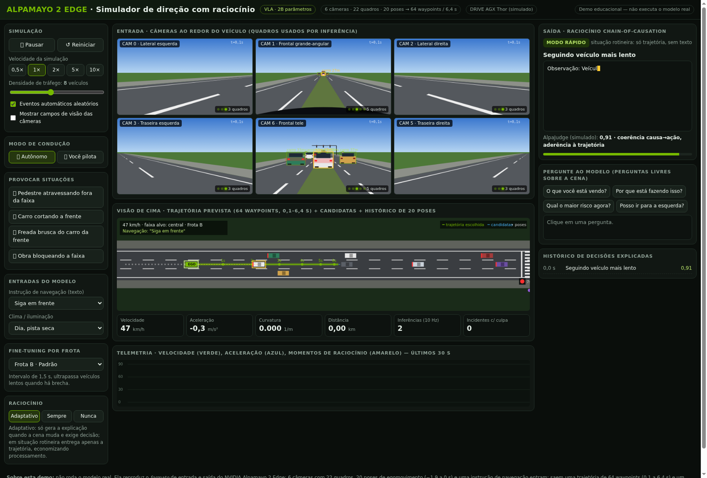

# Alpamayo 2 Edge Simulator (educational demo)

Interactive web demo inspired by the [NVIDIA Alpamayo 2 Edge](https://huggingface.co/nvidia/Alpamayo2-Edge), a VLA (Vision-Language-Action) model for autonomous driving.

**It does not run the real model.** The car is driven by a simple rule-based planner; the demo reproduces the model's *input/output format*:

- Input: 6 cameras (22 frames per inference), 20 history poses and a text navigation instruction.
- Output: a 64-waypoint trajectory (6.4 s) and, when needed, Chain-of-Causation reasoning with a (simulated) AlpaJudge score.

Features: triggered events (jaywalking pedestrian, cut-in, sudden braking, road work), weather, fleet profiles, adaptive reasoning mode and free-form questions.

## "You drive" mode

Under **Driving mode**, choose **You drive**:

- Up/W accelerates, Down/S brakes, Left/A and Right/D change lanes, Space is the hard brake (or hold the on-screen buttons).
- In the top-down view, the white dotted line is your path and the green/yellow line is what the model would do.
- The panel shows the model's suggestion, your % of agreement, assistant interventions and red lights run.
- With the **safety assistant** on, the model brakes for you and blocks dangerous lane changes; turn it off to drive without a safety net.

## Sound

Sound is generated in the browser itself (Web Audio, no files): engine and wind follow the speed, rain, turn-signal click on lane change, beep when the model reasons, alarm when the assistant intervenes and crash sound. Press **H** to honk. **Sound on/off** button and volume in the Simulation panel. Audio starts on the first page click (browser requirement).

## How to open

Single file, no dependencies: open `index.html` directly in your browser (double-click).
